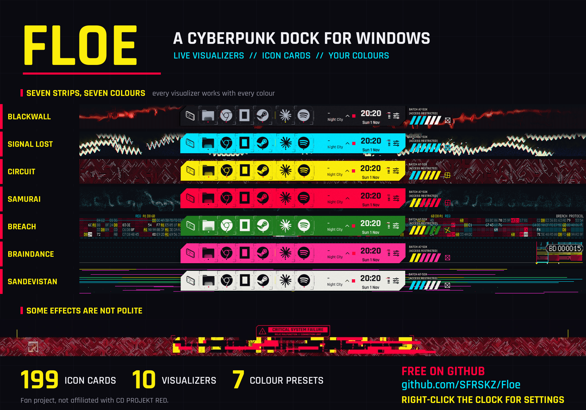

# Floe

A free dock for Windows with live GPU visualizers. It comes in two editions: a liquid-glass dock, and a Cyberpunk edition.



## Download

Get the latest setup from [Releases](https://github.com/SFRSKZ/Floe/releases/latest):

- **FloeSetup.exe**: the standard dock
- **FloeCP77Setup.exe**: the Cyberpunk edition

Floe needs Windows 10 version 2004 or later. The setups are not code signed, so Windows SmartScreen may warn you on first run.

## Features

**Both editions**

- A dock at the bottom of the screen with your pinned and running apps
- Window previews on hover
- Media controls, weather and a clock in the dock
- Live visualizers that react to the music you play
- WebGL2 visualizer plugins: drop a folder in and pick it in Settings (Tidepool ships with the app)
- Option to hide the Windows taskbar
- English and Turkish

**Cyberpunk edition**

- 10 cyber visualizers, including Blackwall, Signal Lost, Circuit, Samurai, Breach, Braindance and Sandevistan
- 199 Cyberpunk icon cards, and apps without a card get one made from their own icon
- 7 colour presets, plus your own colours for the body, accent, strip and ink
- Hex click effect, click sound, drag and file drop frames, and sleep and wake effects

## Using it

- **Right-click the clock** to open Settings
- **Right-click an icon** for its menu, where you can pin it or change its icon
- **Right-click the dock** for quick actions such as Show Desktop, Task Manager and Quit
- **Ctrl+Alt+V** toggles veil mode

## Visualizer plugins

The dock's visualizers are pluggable: a plugin is a folder with `manifest.json` and a WebGL2 page, run
in its own WebView2 process behind the dock's glass. **Tidepool** (Gelgit) is the reference plugin and
ships in `plugins/tidepool`.

- Authoring guide: [plugins/README.md](plugins/README.md)
- Design notes and the WebGL2 host: [docs/visualizer-plugins.md](docs/visualizer-plugins.md)

Drop a plugin folder into `%LOCALAPPDATA%\Floe\plugins` (or `plugins` next to `Floe.exe`), then pick it
under **Settings → Glass → WebGL (plugin)**.

## Build from source

You need the .NET 8 SDK.

```bash
dotnet build src/Floe.App -c Release
dotnet build src/Floe.App -c Release -p:FloeProduct=CP77
dotnet test tests/Floe.Tests -c Release
```

The build copies `plugins/` next to the executable, so the preview build has Tidepool out of the box.

---

Fan project, not affiliated with CD PROJEKT RED.
