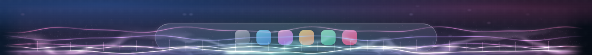
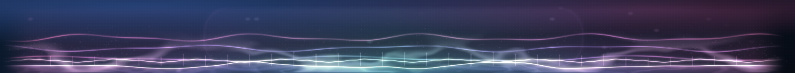
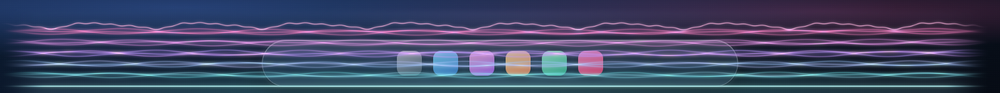
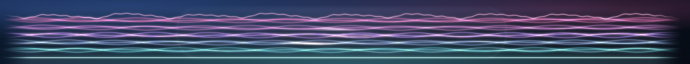
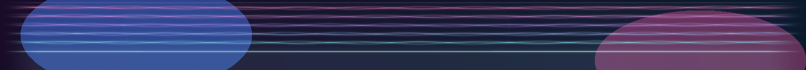
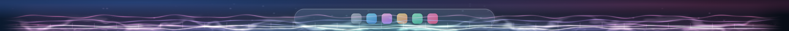
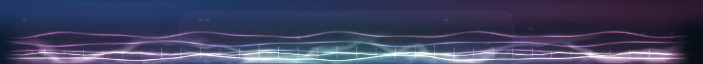
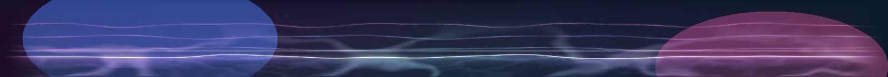

# Floe görselleştirici eklentileri — tasarım

Floe'nin görselleştiricileri şimdiye kadar uygulamanın içinde, WPF çizimi ya da D3D11 sahnesi olarak
yaşıyordu; yeni bir stil eklemek `VisualizerStyle`, `VisualizerWindow`, `SettingsWindow` ve gölgelendirici
derleyicisine dokunmak demekti. Bu tasarım, görselleştiriciyi **değiştirilebilir bir eklenti** hâline
getiriyor: `manifest.json` + WebGL2 sayfası olan bir klasör, Floe'nin ayarlarında bir seçenek oluyor.
Depoyla iki tasarım geliyor: **Tidepool (Gelgit)**, sıvı cam gelgitleri; ve **Loom (Dokuma)**, ışıktan
dokunmuş ipek bir kumaş.





### Loom (Dokuma)

Tidepool'un sıvı diline karşı daha sakin, lifli bir tasarım: beş örgü, her biri üç ipekten; alttan
yukarı turkuazdan pembeye giden bir renk sırası, altta parlak bir kenar teli ve vuruşta örgülerin üzerinde
kayan bir mekik düğümü. Spektrum, her örgünün parlaklığını ve salınımını sürüyor; osiloskop izi en üstte
altın bir tel olarak dokunun içinden geçiyor.








---

## 1. Neden WebGL2 + WebView2

Floe bir WPF uygulaması ve GPU katmanı Direct3D 11 + DirectComposition ile çiziyor. Buradaki üç kısıt
tasarımı belirledi:

1. **Taşınabilirlik.** Görselleştirici yazacak kişi büyük olasılıkla GLSL biliyor; HLSL + Vortice +
   swap-chain kurmak istemiyor. WebGL2, GLSL ES 3.00 ile aynı fikirleri taşıyor ve tarayıcıda
   önizlenebiliyor.
2. **İzolasyon.** Üçüncü taraf bir eklenti kendi sürecinde yaşamalı: bir gölgelendirici hatası Floe'yi
   düşürmemeli. WebView2 zaten ayrı bir renderer süreci veriyor.
3. **Şeffaflık.** Floe'nin görselleştiricisi ekranın altında, dock'un arkasında duran bir şerittir;
   arkasındaki duvar kâğıdı görünmelidir. WebView2'nin **composition controller**'ı, sayfayı bir
   DirectComposition görseli olarak verir; katmanlı (`WS_EX_LAYERED` + `WS_EX_NOREDIRECTIONBITMAP`)
   pencerede bu görsel gerçek alfa ile masaüstüne karışır. Bu yol denendi ve doğrulandı (bkz. §8).

Alternatifler ve neden seçilmediler:

| Seçenek | Sorun |
| --- | --- |
| Eklentiyi HLSL olarak derlemek | Üçüncü taraf kodu ana süreçte, sürücü hatalarına açık; yazma eşiği yüksek |
| WebGL2'yi penceresiz (windowed) WebView2'de göstermek | Pencere opak kalıyor; per-piksel alfa yok |
| Çıktıyı okuyup dokuya kopyalamak | Her karede GPU→CPU→GPU kopyası; 60 fps'te bütçeyi yiyor |
| Ayrı bir tarayıcı penceresi | Dock ile z-sırası/şeffaflık yönetilemez |

---

## 2. Katmanlar

```
┌──────────────────────────── Floe (WPF, .NET 8) ────────────────────────────┐
│  SettingsWindow ──► GlassSettings (PluginId)                                │
│        │                     │                                             │
│        └──► VisualizerPlugins ──► VisualizerPluginCatalog (manifest tarama)  │
│                                      │                                     │
│  VisualizerWindow ──► WebVisualizerHost ──► WebView2 (ayrı süreç)           │
│        │                    │                  │                           │
│        │                    │                  └── plugins/tidepool/*.html  │
│        │                    ├── DirectComposition görseli                   │
│        │                    └── AudioSpectrum ──► JSON çerçeve ──► sayfa    │
│        └── WPF/GpuLayerWindow yolları (diğer stiller)                       │
└─────────────────────────────────────────────────────────────────────────────┘
```

| Proje | Sorumluluk |
| --- | --- |
| `src/Floe.Plugins` | Manifest okuma/doğrulama, katalog, ayar dosyası, köprü protokolü, WebView2 host'u |
| `src/Floe.App` | Seçim, ayarlar UI, palet, görselleştirici penceresiyle entegrasyon, geri düşme |
| `plugins/<id>` | HTML + JS + GLSL; Floe'den bağımsız önizlenebilir |
| `tests/Floe.Tests` | Manifest/katalog/protokol birim testleri |

Host bilinçli olarak WPF'e bağlı değil: `Floe.Plugins` içinde `System.Windows` yok. Böylece aynı host
konsol bir deneme uygulamasında, hatta ileride ayrı bir "görselleştirici önizleme" aracında çalışabilir.

---

## 3. Eklenti sözleşmesi

### 3.1 Manifest

```json
{
  "schemaVersion": 1,
  "apiVersion": "1.0",
  "id": "floe.tidepool",
  "version": "1.0.0",
  "name": { "en": "Tidepool", "tr": "Gelgit" },
  "entry": "index.html",
  "preview": "preview/preview.html",
  "capabilities": ["audio.bands", "audio.wave", "audio.onsets", "audio.stereo",
                    "host.palette", "host.dockGeometry", "host.clock"],
  "audio": { "bands": 32, "wave": 512, "waveRateHz": 60 },
  "render": { "transparent": true, "frameBudgetMs": 16.6, "minHeight": 48, "maxPixels": 3000000 },
  "options": [ /* … */ ]
}
```

Doğrulama kuralları (`VisualizerPluginReader`) güvenlik sınırının tamamıdır:

- `id`: `^[a-z][a-z0-9-]{1,31}(\.[a-z][a-z0-9-]{0,31})+$` — klasör adı değil, kimlik.
- `apiVersion`: ana sürüm 1 olmalı; ileride 2.x geldiğinde eski host yeni eklentiyi yüklemez.
- `entry`: yalnızca eklenti klasörünün içinde, `.html`; `..` ve kök yollar reddedilir.
- `capabilities`: bilinen küme dışındaysa reddedilir (host yapamayacağı bir şeyi vaat etmez).
- `audio`: 4–64 bant (host bu sayıda yollar), 512 dalga örneği (API 1.x'te sabit), 15–120 Hz dalga hızı.
- `render`: 4–40 ms bütçe, 24–400 px en az yükseklik, 100k–16M piksel.
- `options`: kimlik biçimi, tekillik, `number` için `min < max`, `enum` için değer listesi ve varsayılan
  tutarlılığı.
- Manifest 512 KB'ı geçemez; bozuk JSON, eksik giriş dosyası ve bilinmeyen şema sürümü reddedilir.

Katalog iki kökü tarar: `%LOCALAPPDATA%\Floe\plugins` (kullanıcı) ve `Floe.exe` yanındaki `plugins`
(paketlenmiş). Aynı kimlik iki yerde varsa kullanıcı klasörü kazanır; diğeri "reddedilenler" listesine
gerekçesiyle düşer ve Ayarlar'da sessizce yok sayılmaz.

### 3.2 Köprü protokolü

Host, WebView2 üzerinden iki tür JSON iletisi yollar; eklenti üç tür ile cevap verir.

**Host → eklenti**

| `type` | Ne zaman | Alanlar |
| --- | --- | --- |
| `state` | Boyut, dock geometrisi, palet, seçenekler veya çalışma durumu değiştiğinde | `w`, `h` (CSS px), `dpr`, `dock` `[sol, sağ, alt, üst]` (şerit içinde 0..1), `palette` `{core, second, accent, deep}`, `options`, `fpsCap`, `running` |
| `frame` | Görselleştirici çalışırken, `fpsCap` hızında (varsayılan 60) | `t` (saniye), `bands[32]`, `bass`, `mid`, `treble`, `level`, `kick`, `snare`, `hat`, `balance`, `wave[512]` |

**Eklenti → host**

| `type` | Anlamı |
| --- | --- |
| `ready` | Sayfa yüklendi; host bunu beklemeden de çalışabilir ama günlüklerde görünür |
| `perf` | `fps`, `ms`, `tier`; host son değerleri saklar (Ayarlar/telemetri için) |
| `error` | `message`; host hatayı kaydeder ve eklentiyi ölü sayar (Floe düşmez) |

Tasarım kararları:

- **Bantlar ve dalga ayrı ölçeklerde.** `bands` logaritmik, kendi son yükseğine göre normalize; `wave`
  mono, yükselen sıfır geçişinden hizalı, −1..1. Eklenti ham FFT görmüyor: sözleşme kararlı kalıyor.
- **60 Hz çerçeve, 120 Hz ekran.** Eklenti kendi tarafında enterpolasyon yapar (`signal.js`); host saat
  farkını yavaş bir EMA ile takip eder, böylece tek bir gecikme animasyonu sıçratmaz.
- **Olaylar ayrı.** `kick/snare/hat` 0..1 vuruş gücü; eklenti bunları kısa zarflara çevirir. Böylece
  "vuruş" hissi eklentiye değil, analiz katmanına ait olur ve tüm eklentiler aynı tepkiyi verir.
- **Stereo denge.** `balance` −1..1, WASAPI kanal tepe değerlerinden; pan ve asimetri için.
- **Palet.** Host, Floe'nin kendi palet üreticisini (`VisualizerPalette`) kullanıp dört renk yollar:
  şeridin ortası (`core`), çeyrek (`second`), uç (`accent`) ve koyu ton (`deep`). "Otomatik" palet bu
  yüzden dock ile aynı ışıkta durur.

### 3.3 Yaşam döngüsü

1. Kullanıcı Ayarlar'dan **WebGL (eklenti)** stilini ve bir eklenti seçer (`GlassSettings.PluginId`).
2. `VisualizerWindow.SetRunning` ilk kez çalışırken `WebVisualizerHost` oluşturulur; host kendi STA
   iş parçacığında pencereyi, D3D11 cihazını, DirectComposition ağacını ve WebView2 ortamını kurar.
3. Sayfa `https://floe.plugin/<entry>` adresinden yüklenir (klasör sanal host'a eşlenir).
4. Şarkı başladığında host `running=true` yollar, pencere görünür olur, çerçeveler akmaya başlar.
5. Şarkı bittiğinde `running=false` yollar; eklenti 380 ms'de söner, host 450 ms sonra pencereyi gizler
   ve ses okuyucuyu bırakır.
6. Stil değişirse host kapatılır (görselleştirici belleği serbest kalır); bir sonraki seçimde yeniden
   kurulur. Host kurulamazsa (WebView2 yok, sürücü reddetti) Floe **Yıldız tozu**'na düşer ve bir daha
   denemez (`_webFailed`).

---

## 4. Host'un ayrıntıları

`WebVisualizerHost`, Floe'nin `GpuLayerWindow` desenini izler: tek bir arka plan iş parçacığı pencereyi,
D3D11/DComp'u, WebView2'yi ve ses okumasını sahiplenir; WPF iş parçacığı yalnızca küçük istekler bırakır
(`Place`, `SetAppearance`, `SetRunning`).

- **Pencere:** `WS_POPUP`, `WS_EX_NOREDIRECTIONBITMAP | LAYERED | TRANSPARENT | TOOLWINDOW | NOACTIVATE |
  TOPMOST`; `WM_NCHITTEST` → `HTTRANSPARENT`, `WM_MOUSEACTIVATE` → `MA_NOACTIVATE`. Tıklamalar dock'a
  geçer, pencere asla etkinleşmez.
- **Kompozisyon:** `IDCompositionDevice` + HWND hedefi + kök görsel + WebView2 görseli. WebView2'nin
  `RootVisualTarget`'ı **RCW** ile verilir: Vortice nesnesi doğrudan verilince sarmalayıcı "UI thread"
  hatası üretiyor; `Marshal.GetObjectForIUnknown(visual.NativePointer)` kabul ediliyor.
- **Şeffaflık:** `controller.DefaultBackgroundColor = Color.Transparent` yalnızca alfa 0/255 kabul eder;
  sayfa `background: transparent` ve premultiplied canvas ile çizer.
- **DPI:** `BoundsMode = UseRawPixels`, `RasterizationScale = ppd`, `ShouldDetectMonitorScaleChanges =
  false`; host fiziksel piksel dikdörtgenini alır, CSS boyutunu (`px / ppd`) eklentiye bildirir.
- **Z-sırası ve yakalama:** pencere dock'un hemen altına yerleştirilir (`WindowStyling.PlaceBelow`) ama
  dock'un arka plan yakalamasından **dışlanmaz** (`WindowAffinity.IncludeInCapture`): camın arkasında
  görünmesi için yakalamaya dahil olmalıdır. İlk sürümde yanlışlıkla dışlanıyordu ve eklenti camın
  arkasında kayboluyordu; OLED katmanı da aynı nedenle `capturable` çalışır.
- **Ses:** `AudioSpectrum` (WASAPI loopback, 2048 FFT) 60 Hz'de okunur; `AudioPeakMeter` yalnızca stereo
  denge için. Loopback paket göndermediğinde analiz sıfır döner; eklenti kendi sessizlik zarflarını uygular.
- **Dayanıklılık:** `ProcessFailed` ve `NavigationCompleted` izlenir; eklenti hatası `error` iletisiyle
  host'a düşer. WebView2 yoksa `CreateAsync` istisnası yakalanır, host `Failure` ile döner.

---

## 5. Eklenti tarafı: sinyal işleme

`signal.js` ham çerçeveleri harekete çevirir:

- **Zaman çizelgesi.** Son iki çerçeve tutulur; host saati `performance.now()` ile hizalanır (offset EMA
  %6). Render, iki çerçeve arasında doğrusal enterpolasyon yapar: 30 Hz gelen veri 120 Hz ekranda
  basamak yapmaz.
- **Bant zarfları.** Her bant için ayrı attack (16 ms) / release (85 ms); `bass/mid/treble/level` daha
  yavaş (22–45 ms attack, 180–350 ms release). Böylece vuruşlar keskin, düşüşler yumuşak.
- **Vuruş halkası.** `kick` olayları 4 yuvalı bir halkada yaş + güç olarak tutulur; gölgelendirici bu
  yuvalardan gezinen dalga paketleri üretir (bkz. `surface()`), yani vuruş sadece parlaklık değil,
  yüzeyde gerçekten yayılan bir dalga olur.
- **Dalga dokusu.** 512 örnek, R16F iki dokuya dönüşümlü yüklenir; `waveMix` 12/s hızında 0→1 gider.
  Şerit çizerken eski ve yeni dalga karışır; osiloskop izi bu yüzden akıcı kalır.
- **Sessizlik.** 350 ms yeni çerçeve gelmezse (host durdu, cihaz değişti) değerler 0.4 s'de sıfıra
  çekilir; görselleştirici kendiliğinden söner.

---

## 6. Render grafiği

```
sahne (emissive, ss) ──► parlaklık eşiği ──► yatay blur ──► dikey blur ──► composite ──► canvas
        │
        └── instanced toz / serpinti / kor
```

Dört geçiş + bir parçacık geçişi:

1. **Sahne** (tam ekran, RGBA16F, 1.25–1.55× supersample): su yüzeyi (SDF yükseklik alanı), gövde ve
   kostikler, yansıma, üç ipek şerit, aynalanmış spektrum tarağı, osiloskop izi, toz parıltıları ve
   kapsül kenar ışığı. Hepsi analitik; çizgi kalınlıkları `fwidth` yerine piksel biriminde hesaplanır,
   böylece 8:1 ile 30:1 arasındaki her oranda aynı keskinlikte kalır.
2. **Parçacıklar** (instanced, 1100–3400): toz, vuruşla fırlayan serpinti, kapsül kenarında kor. Konumlar
   gölgelendiricide zamana ve sese göre hesaplanır; CPU her karede tek bir çizim çağrısı yapar.
3. **Bloom**: eşik 0.66, yarım çözünürlükte 9 tap ayrılabilir Gauss; güç 0.55 × 0.62.
4. **Composite**: premultiplied çıktı, hafif grain (8-bit bantlanmayı önler), `Fade` ile sönme.

**Premultiplied alfa kuralı.** Sahne `lit` (ışık) ve `mask` (kapsama) biriktirir; sonda
`a = max(mask, luma)`, `col = min(lit, a)` uygulanır. Bu, parlak ince çizgilerin opak ve doygun
kalmasını, karanlık suyun ise duvar kâğıdını göstermesini sağlar. Aksi hâlde (alfa'yı yalnızca `mask`
yapmak) tüm sahne pastel bir sise dönüşüyordu.

**Kalite kademeleri** (`engine.js`): yüksek (1.55×, 3400 parçacık), dengeli (1.25×, 2000), düşük (1.0×,
1100); her kademede piksel tavanı var. Otomatik kipte kare maliyeti 21 ms üstünde 45 kare kalırsa bir
kademe iner, 12 ms altında 150 kare kalırsa bir kademe çıkar. Bu, "akıcı"nın zayıf GPU'da da korunması
için.

---

## 7. Ayarlar ve geri düşme

- `GlassSettings.VisualizerStyle.Plugin` + `GlassSettings.PluginId` (glass.json'da `PluginId`).
- Ayarlar > Cam > **WebGL (eklenti)** radyosu; altında eklenti listesi (manifest adları, TR/EN) ve
  "Eklenti klasörünü aç" düğmesi.
- Eklenti seçenekleri manifestte tanımlanır (`intensity`, `palette`, `motion`, `particles`, `quality`);
  değerler `%APPDATA%\Floe\plugins.json` içinde eklenti başına saklanır ve `state.options` ile gönderilir.
- Host kurulamazsa görselleştirici **Yıldız tozu**'na düşer; kullanıcıya sessiz kalmamak için hata
  `Debug` günlüğüne ve host `Failure` alanına yazılır.

---

## 8. Doğrulama

- **Birim testleri** (28): manifest doğrulama, yol kaçışı, API sürümü, bilinmeyen yetenek, kopya
  seçenek kimliği, katalog önceliği, ayar turu, seçenek birleştirme, 512 örneklik dalga sözleşmesi,
  `state`/`frame` JSON şekli. `dotnet test tests/Floe.Tests -c Release`.
- **Tarayıcı önizlemesi:** `plugins/tidepool/preview/preview.html` (sentetik 122 BPM set, duvar kâğıdı
  ve cam kapsül taklidi). Headless Chrome ile 1600×150 kareler alındı; `docs/tidepool-*.png`.
- **En-boy oranı dayanıklılığı:** aynı sahne 25:1 (3000×120) ve 11:1 (1200×110) oranlarında da
  çizildi; çizgi kalınlıkları piksel biriminde kaldığı için keskinlik ve su hattı tutarlı.

  

  

- **Uçtan uca host denemesi:** `tools/PluginProbe`, gerçek `WebVisualizerHost`'u gerçek WebView2 ile
  çalıştırır, şeridi çizimli bir duvar kâğıdının üstüne koyar, sentetik ses besler ve ekran görüntüsü
  alır. Şeffaflık, DPI, köprü ve kalite yükseltmesi burada doğrulandı (`fps=60`, `tier=high`).

  ```powershell
  dotnet run --project tools/PluginProbe -c Release
  # %TEMP%\floe-plugin-probe.log ve %TEMP%\floe-plugin-probe.png
  ```

  

- **Bulunan iki tuzak** (belgelenmeye değer): (a) WebView2 sarmalayıcısı `RootVisualTarget` olarak
  Vortice nesnesini kabul etmiyor, RCW gerekiyor; (b) GLSL'de `pow(negatif, 2.0)` NaN üretip yarım
  float hedefte blok bozulmalarına yol açıyor — tüm kareler `bell()` ve `ramp()` yardımcılarına çevrildi.

---

## 9. Sınırlar ve yol haritası

- **WebView2 Runtime** gerekir (Windows 10 2004+ ile genelde kurulu; kurulu değilse eklenti devre dışı
  kalır ve Floe yerleşik stile düşer). Kurulum paketinin Evergreen Runtime'ı kontrol etmesi önerilir.
- Eklenti başına ~1 ek renderer süreci; aynı anda yalnızca bir eklenti çalışır.
- Ayarlar'da şu an yalnızca eklenti seçimi var; seçenekler için genel bir arayüz (manifest'ten slider/
  toggle üretimi) yol haritasında.
- Sıcak yeniden yükleme (klasör değişince otomatik yenileme), çoklu monitör ve eklenti mağazası
  sonraki adımlar.
- Gölgelendirici önbelleği (`KHR_parallel_shader_compile`) ve `EXT_disjoint_timer_query` ile daha
  hassas bütçe ölçümü değerlendirilebilir.

